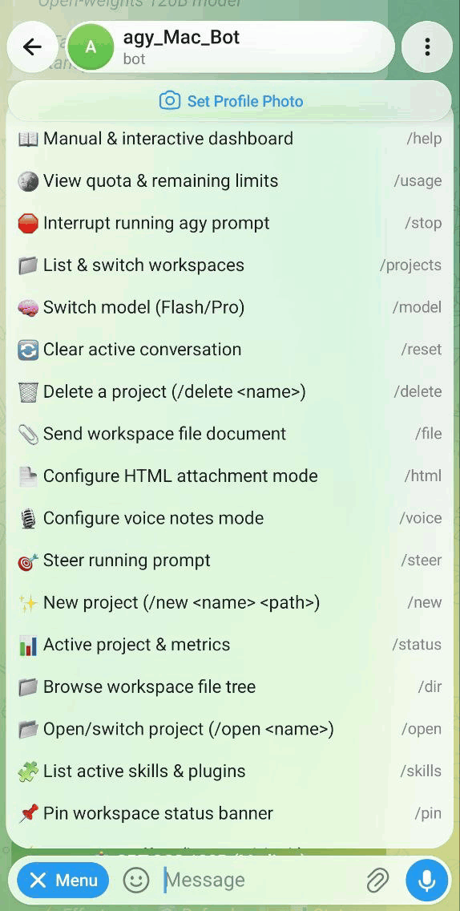
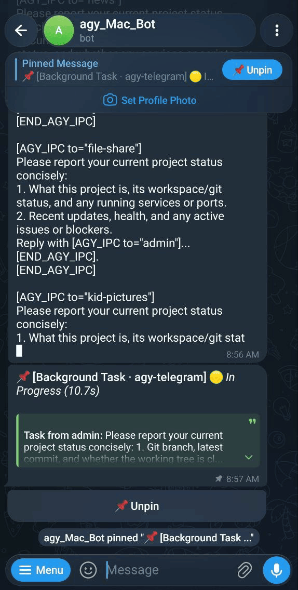
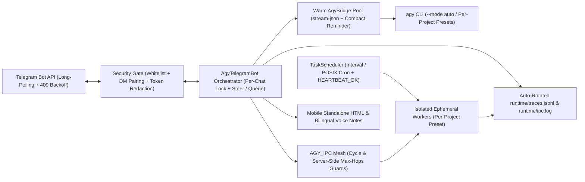
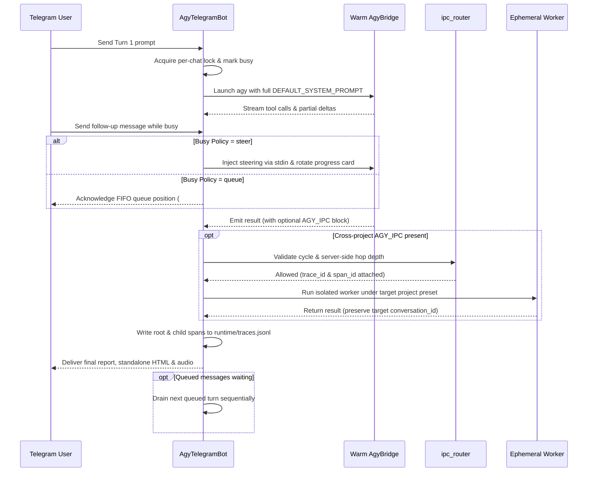

# agy-telegram — Direct Telegram Gateway for agy (Antigravity CLI)

[](https://github.com/Jim2014/agy-telegram/actions/workflows/test.yml)


A lightweight, real-time Telegram gateway for interacting directly with `agy` (Antigravity CLI) from Telegram. Stream **thinking progress, tool calls, and live partial outputs**, send **mid-flight steering instructions**, and control workspaces with `/` slash commands — without any intermediate proxy overhead.

---

## Table of Contents
- [Live Demos](#live-demos)
- [Why agy-telegram?](#why-agy-telegram)
- [Engineering Challenges Solved](#engineering-challenges-solved)
- [System Architecture & Execution Flow](#system-architecture--execution-flow)
- [Main Features](#main-features)
- [⚠️ Limitations & Security Notice](#%EF%B8%8F-limitations--security-notice)
- [Prerequisites](#prerequisites)
- [Environment Setup](#environment-setup)
  - [Quick Start (Recommended): `./setup.sh`](#quick-start-recommended-one-command-interactive-setup-setupsh)
  - [Manual Conda / `venv` Setup](#manual-option-a-conda-environment-recommended-env-agy-telegram)
- [Runtime Isolation (`runtime/`)](#runtime-isolation-runtime)
- [Configuration Guide (`.env`)](#configuration-guide-env)
- [Starting and Managing the Service](#starting-and-managing-the-service)
- [Telegram Commands & Interactive UI](#telegram-commands--interactive-ui)
- [Architecture & Module Overview](#architecture--module-overview)
- [Testing & Verification](#testing--verification)
- [Disclaimer](#disclaimer)
- [Contributing](#contributing)
- [License](#license)

---

## Live Demos

<table>
  <tr>
    <td align="center" width="50%">
      <strong>Interactive Controls &amp; Quota Monitor</strong><br />
      <sub>Adaptive <code>/</code> menu &middot; <code>/model</code> &middot; <code>/effort</code> &middot; <code>/usage</code></sub><br /><br />
      
    </td>
    <td align="center" width="50%">
      <strong>Cross-Project <code>AGY_IPC</code> &amp; Pinned Tasks</strong><br />
      <sub>Multi-workspace dispatch &middot; live pinned status &middot; expandable tool trace</sub><br /><br />
      
    </td>
  </tr>
</table>

---

## Why agy-telegram?

Generic multi-agent bot wrappers and remote terminal hacks often fall short when you want to work with **Google Antigravity CLI (`agy`)** from your phone:

- **Zero Middleman LLM Overhead:** Generic agent harnesses that wrap CLI tools inside another outer LLM loop burn extra API tokens, add latency, and dilute context just to relay your prompt. `agy-telegram` connects **directly** to the official `agy` CLI (`stream-json`) on your machine — **0 extra proxy tokens**.
- **Works Directly With Your Local `agy` Setup (No OAuth Scraping):** Uses your own authenticated local `agy` binary directly—including auto-discovered `/model` options, workspace `.gemini/rules`, skills, and zero-token `/usage` quota checks—without touching or proxying OAuth credentials.
- **Designed as a Mobile Coding Cockpit:** Instead of slow walls of raw text on a small phone screen, you get live collapsible tool progress (`<blockquote expandable>`), **mid-flight steering** while `agy` is working, one-tap `[AGY_ACTIONS]` decision buttons, mobile-responsive HTML viewers for diffs/code/directory trees (`/file -h`, `/dir`), and hands-free voice input + spoken podcast summaries (`/voice`).
- **Clean Multi-Project Isolation:** Switch across local repositories (`/new`, `/open`) with independent `conversation_id` persistence, token/duration tracking, and a live pinned workspace banner (`/pin`).

---

## Engineering Challenges Solved

- **Zero-Proxy Bidirectional `stream-json` Steering & Warm Process Pool (`gateway/agy_bridge.py`):** A single-coroutine stdout reader queue prevents asyncio `readuntil()` collisions while allowing live `stdin` steering and keeping the active `agy` subprocess warm across turns—automatically restarting whenever the model, reasoning effort, permission preset, or workspace changes.
- **Follow-Up Prompt Deduplication (`gateway/agy_bridge.py`, `gateway/config.py`):** Injects the full ~6.9 KB output protocol guide only on fresh sessions, while resumed and warm-reused turns receive only a compact single-line `COMPACT_TURN_REMINDER` (~96% per-turn protocol token overhead reduction).
- **Defense-in-Depth Security & Zero Listening Ports (`gateway/session_manager.py`, `gateway/pairing.py`, `main.py`):** Defaults to `agy --mode auto` (native OS terminal sandbox), isolates `permission_preset` per project so an elevated `turbo` workspace never leaks into cross-project IPC or scheduled runs, enforces deny-by-default DM pairing with `0600` atomic stores, redacts `/bot<token>` URLs from logs, and delivers standalone mobile HTML directly via Telegram with zero open local HTTP ports.
- **Loop-Safe Multi-Hop `AGY_IPC` Mesh & Structured Span Tracing (`gateway/ipc_router.py`, `gateway/bot.py`):** Enforces server-side hop depth (`max(hop_count, len(visited))`), self-delegation and transitive cycle detection, non-clobbering ephemeral workers (`last_ipc_conversation_id`), and auto-rotated `runtime/traces.jsonl` logging `agent_turn`, nested `ipc_call`, and `scheduled_task` spans across `SUCCESS`, `TIMEOUT`, `ERROR`, and `CANCELLED` exits.
- **Concurrency-Safe Orchestration & Self-Restart Handshake (`gateway/bot.py`, `gateway/telegram_client.py`, `restart.sh`):** Per-chat `asyncio.Lock` eliminates double-message admission races, `getUpdates` propagates HTTP `409 Conflict` for clean polling backoff, `/busy` switches cleanly between immediate `steer` and FIFO `queue` draining, and `runtime/turn_active.lock` + `runtime/restart.requested` defers restarts until active final reports finish sending.
- **Zero-Dependency Cron & Quiet Heartbeat Scheduler (`gateway/scheduler.py`):** Pure-Python interval (`30m`, `6h`, `1d`) and POSIX 5-field cron matcher (`0 8 * * 1-5`) with per-task overlap protection, isolated ephemeral workers, and `HEARTBEAT_OK` alert suppression.

---

## System Architecture & Execution Flow

### Overall Gateway Architecture



### Mid-Flight Steering, Queue Policy & Multi-Hop IPC Sequence



---

## Main Features

- **Direct Real-Time Streaming via Telegram**: Built on Telegram Long-Polling (no public IP or webhook required) to stream `agy` thinking progress, live tool calls, and partial outputs directly to mobile.
- **Mid-Flight Steering, Queue Mode & Warm Process Pool**: Send follow-up text, voice notes, files, or `/steer` while `agy` is working to steer the active turn seamlessly — or switch `/busy queue` to buffer up to 10 follow-up messages for sequential execution.
- **Multi-Project & Per-Project Permission Isolation**: Manage separate workspaces (`/new`, `/open`, `/projects`, `/delete`, `/reset`), each with its own directory path, `conversation_id`, isolated `permission_preset`, token/duration stats, and pinned status banner (`/pin`).
- **Proactive Cron & Heartbeat Scheduler (`/schedule`, `/heartbeat`)**: Schedule recurring interval (`30m`, `6h`) or 5-field cron tasks and quiet workspace heartbeats (`HEARTBEAT_OK` suppression) backed by persistent `0600` job stores (`runtime/schedules.json`).
- **Dynamic Model & Effort Controls**: Auto-discovers available models from `agy models` via `/model` (with refresh) and adjusts reasoning depth via `/effort` (`low` / `medium` / `high`).
- **Rich Mobile-First Output**: Converts Markdown to Telegram HTML and renders code/diffs/CSVs/directory trees as standalone mobile-friendly HTML documents sent directly in Telegram (`/file -h`, `/dir`, `/export`, `/html`, `[AGY_FILE]`) — zero open local HTTP ports needed.
- **Voice Interaction (Offline STT + Bilingual TTS)**: Transcribes Telegram voice messages offline via `faster-whisper` and generates spoken audio summaries (`[AGY_VOICE]`) with on-demand playback buttons or auto-send (`/voice`).
- **One-Tap Setup & Hardened Access Control**: Interactive `./setup.sh` wizard with live token verification and automatic Chat ID detection, **deny-by-default** authorization with **DM pairing** (`gateway.pairing`), bot-token log redaction, crash watchdog (`watchdog.sh`), and macOS LaunchAgent autostart.
- **Cross-Project Multi-Agent Mesh (`AGY_IPC`)**: Dispatches tasks across registered project directories with cycle detection, `max_hops` limits (`IPC_MAX_HOPS`), UUID `trace_id` propagation, pinned expandable progress cards, and structured audit/span logs (`runtime/ipc.log`, `runtime/traces.jsonl`).
- **Automated Test Suite**: **195 tests** covering unit logic, scheduler cron/heartbeats, Telegram API resilience, protocol extraction, onboarding setup, DM pairing, deferred restarts, CLI script safety, and live `agy` CLI smoke testing (see [ROADMAP.md](ROADMAP.md)).

---

## ⚠️ Limitations & Security Notice

> [!WARNING]
> **Please read carefully before deploying on a personal or production machine:**
>
> 1. **Platform Testing Scope (macOS Tested Only):**
>    `agy-telegram` has only been tested on **macOS** (Apple Silicon). It should also work on **Linux** or inside a **Virtual Machine / Container** (note: macOS-specific features like `launchd` autostart and `say` offline TTS fallback are skipped on Linux, while Edge-TTS works cross-platform), though non-macOS environments have not been formally tested.
> 2. **Tool & Shell Execution Permissions (`AGY_PERMISSION_PRESET` / `/permissions`):**
>    By default (`AGY_PERMISSION_PRESET=auto`), `agy-telegram` launches `agy` with `--mode auto` (native OS terminal sandbox on macOS/Linux; workspace edits and safe reversible commands auto-approved while high-risk unsandboxed commands are blocked). You can switch anytime via `/permissions` (or `/perm`) to **`accept-edits`**, **`plan`** (read-only analysis), or **`turbo`** (`--dangerously-skip-permissions`).
>    - **Strongly Recommended:** Keep `auto` (default) or run `agy-telegram` inside an **isolated container (Docker) or Virtual Machine (VM)** if you switch to unrestricted `turbo` mode.
>    - Always keep `ALLOW_ALL_CHATS=false` and configure `ALLOWED_CHAT_IDS` + DM pairing so unauthorized Telegram users cannot reach your bot.

---

## Disclaimer

- **Terms Compliance & Personal Single-User Use:** `agy-telegram` invokes the official, unmodified local `agy` CLI binary in headless mode and does **not** extract, scrape, or proxy Google OAuth tokens. Users are responsible for complying with Google Antigravity's Terms of Service—keep `ALLOW_ALL_CHATS=false` with `ALLOWED_CHAT_IDS` restricted strictly to **your own personal Telegram account**, and do not use this gateway for multi-user sharing, quota harvesting, or commercial redistribution.
- **Use at Your Own Risk:** This software is provided *"AS IS"*, without warranty of any kind. Because `agy-telegram` enables autonomous AI execution with local tool and shell permissions (sandboxed `--mode auto` by default, and optionally unrestricted `--dangerously-skip-permissions` in `turbo` mode), **you are solely responsible** for any commands executed, files modified or deleted, system changes, API/model quota usage, or unintended behavior resulting from running this tool. The author and contributors assume no liability for any damages or data loss.
- **No Official Affiliation:** `agy-telegram` is an independent open-source project and is not affiliated with, endorsed by, or officially connected to Google, Antigravity, or Telegram.

---

## Prerequisites

Before cloning and running `agy-telegram`, make sure you have:
- **Antigravity CLI (`agy`)** installed and authenticated on your machine (verify with `agy --version` and `agy models`).
- **Python 3.10+** (or **Miniconda / Anaconda**).
- **Telegram** account (mobile or desktop).
- *Optional:* `ffmpeg` installed if you want macOS offline TTS audio fallback (`brew install ffmpeg`).

---

## Environment Setup

First, clone the repository:

```bash
git clone https://github.com/Jim2014/agy-telegram.git
cd agy-telegram
```

### Quick Start (Recommended): One-Command Interactive Setup (`./setup.sh`)

Run the interactive onboarding wizard to create the Python environment (Conda `agy-telegram` or `venv`), verify your Telegram bot token via `getMe`, auto-detect your Telegram `chat_id` when you send `/start`, write `.env` with `0600` permissions, and validate the setup:

```bash
./setup.sh
```

*(Pass `./setup.sh --venv` to force Python `venv` instead of Conda, or `./setup.sh --check` to validate an existing config.)*

---

### Manual Option A: Conda Environment (Recommended, env: `agy-telegram`)

An `environment.yml` (Python 3.10) is provided:

```bash
# 1. Create and activate the conda environment
conda env create -f environment.yml
conda activate agy-telegram

# 2. Verify or update Python dependencies (if needed)
pip install -r requirements.txt
```

### Option B: Python `venv`

```bash
# 1. Create virtual environment
python3 -m venv venv

# 2. Install dependencies
./venv/bin/pip install -r requirements.txt
```

---

## Runtime Isolation (`runtime/`)

To keep the repository clean and prevent runtime data from entering Git history:

```text
agy-telegram/
├── runtime/              # Runtime dynamic data directory (gitignored)
│   ├── gateway.log       # Main gateway logs
│   ├── gateway.pid       # Gateway process PID file
│   ├── ipc.log           # Cross-project IPC audit log (auto-rotated)
│   ├── schedules.json    # Persistent cron & heartbeat tasks (0600)
│   ├── traces.jsonl      # Structured OpenTelemetry-style turn, IPC & scheduled spans
│   ├── watchdog.log      # Watchdog logs
│   ├── watchdog.pid      # Watchdog PID file
│   └── sessions.json     # Persistent chat, project & stats store
├── gateway/              # Core Python gateway modules
├── tests/                # Unit, integration & smoke tests
├── setup.sh              # Interactive first-time setup & Telegram onboarding wizard
├── restart.sh            # Service, watchdog & autostart control script
├── watchdog.sh           # Watchdog auto-restart supervisor script
├── environment.yml       # Conda environment specification
└── README.md
```

- The `runtime/` directory is created automatically on startup.
- Legacy root-level `sessions.json` files are migrated automatically if present.

---

## Configuration Guide (`.env`)

### Step 1: Obtain a Telegram Bot Token

1. Open Telegram and search for the official [@BotFather](https://t.me/BotFather) account.
2. Send `/newbot` and follow the prompts to choose a display name and username (e.g. `my_agy_bot`).
3. Copy the generated API token (format: `123456789:ABCdefGHIjklMNOpqrsTUVwxyz`).

### Step 2: Find Your Telegram Chat ID (Security Whitelist)

> [!NOTE]
> `agy-telegram` enforces **deny-by-default + DM pairing** (`ALLOW_ALL_CHATS=false`, `DM_PAIRING_ENABLED=true`). If `ALLOWED_CHAT_IDS` is empty, unknown senders are denied and receive a pairing code you can approve from the terminal (`python -m gateway.pairing approve <CODE>`). Setting your own Chat ID in `ALLOWED_CHAT_IDS` also enables one-tap `[ ✅ Approve ]` / `[ ❌ Reject ]` notifications in Telegram.

1. Search for [@userinfobot](https://t.me/userinfobot) on Telegram and press **Start**.
2. Copy your numeric **Id** (for example, `123456789`).

### Step 3: Configure `.env`

Create `.env` from the template:

```bash
cp .env.example .env
```

Edit `.env` and fill in at least `BOT_TOKEN` and `ALLOWED_CHAT_IDS`:

```ini
# Required: Bot token from @BotFather
BOT_TOKEN=123456789:ABCdefGHIjklMNOpqrsTUVwxyz

# Comma-separated Telegram Chat IDs allowed to access the bot (deny-by-default if empty).
ALLOWED_CHAT_IDS=
ALLOW_ALL_CHATS=false
DM_PAIRING_ENABLED=true

# agy CLI binary path (defaults to ~/.local/bin/agy or agy in PATH)
AGY_BIN_PATH=~/.local/bin/agy

# Default working directory (--add-dir). Leave empty to use the repository root.
AGY_WORKING_DIR=

# Default model, reasoning effort, and permission preset (auto | accept-edits | plan | turbo)
DEFAULT_MODEL=gemini-3.8-flash
DEFAULT_EFFORT=high
AGY_PERMISSION_PRESET=auto

# Cross-project IPC max hops & structured JSONL trace spans
IPC_MAX_HOPS=3
TRACES_FILE=runtime/traces.jsonl

# Busy-input policy (steer | queue) and proactive scheduler settings
BUSY_MODE=steer
SCHEDULER_ENABLED=true
SCHEDULES_FILE=runtime/schedules.json

# Streaming edit throttle interval in seconds (default: 1.0)
STREAM_THROTTLE_SECONDS=1.0

# Subprocess timeout in seconds (default: 300)
AGY_TIMEOUT_SECONDS=300

# Default HTML attachment mode (auto | explicit | off)
HTML_MODE=auto

# Logging level (INFO / DEBUG) and runtime file paths
LOG_LEVEL=INFO
LOG_FILE=runtime/gateway.log
SESSIONS_FILE=runtime/sessions.json
```

---

## Starting and Managing the Service

### 1. Validate Configuration

```bash
conda run -n agy-telegram python main.py --check-config
# Or via helper script:
./restart.sh --check
```

### 2. Run `agy` CLI Smoke Test

Verify that the local `agy` CLI runs properly and emits `stream-json` events:

```bash
conda run -n agy-telegram python main.py --smoke-test
```

### 3. Start & Manage the Gateway

For a first-time test in the **foreground** (so you can watch live logs directly in your terminal):

```bash
conda run -n agy-telegram python main.py
# Or with venv:
./venv/bin/python main.py
```

Or use `restart.sh` to start and manage the gateway in the **background** (and macOS LaunchAgent autostart):

```bash
# Start or restart the gateway in background
./restart.sh

# Check gateway, launchd, and watchdog status
./restart.sh status

# (macOS only) Enable boot/login autostart via LaunchAgent
./restart.sh autostart

# (macOS only) Disable macOS autostart
./restart.sh autostart-disable

# Start crash auto-recovery watchdog supervisor (Linux / macOS)
./restart.sh watch

# Stop gateway (and watchdog if running)
./restart.sh stop

# Stop only the watchdog
./restart.sh stop-watch
```

Logs are written to `runtime/gateway.log` and `runtime/watchdog.log`:

```bash
tail -f -n 50 runtime/gateway.log
tail -f -n 50 runtime/watchdog.log
```

### 4. First Chat in Telegram

1. Open the bot link provided by `@BotFather` (`https://t.me/<your_bot_username>`) in Telegram and tap **Start** (or send `/help`).
2. You should see the interactive **agy-telegram Command Center** with quick-action buttons.
3. Send any prompt directly (for example: `Summarize this repository`) — on first message, a `default` project is created at `AGY_WORKING_DIR`.
4. Useful first-time setup commands in Telegram:
   - `/new myapp /path/to/your/project` — create and switch to another project workspace
   - `/model` — inspect and select models auto-discovered from `agy models`
   - `/effort` — choose reasoning depth (`low`, `medium`, `high`)
   - `/voice` & `/html` — configure spoken voice notes and automatic HTML report attachments

---

## Telegram Commands & Interactive UI

### Adaptive Slash Menu & Interactive Controls

- **Adaptive Pure-LRU Command Menu**: All 23 commands are registered in the Telegram `/` menu. `/help` stays pinned at position 0, while the most recently used commands automatically float to the top per chat.
- **Pinned Workspace Status Banner (`/pin`)**: Keeps a live pinned status banner at the top of the chat displaying active project, workspace path, model, token totals, uptime, and quick-action buttons (`[ 📊 Status ]`, `[ 📁 Projects ]`, `[ 🪙 Quota ]`, `[ 📖 Help ]`).
- **Interactive Decision & Action Buttons (`[AGY_ACTIONS]`)**: Renders one-tap inline buttons under responses when `ask_question` or `[AGY_ACTIONS]` blocks are returned.
- **Expandable Tool Progress (`<blockquote expandable>`)**: Keeps long tool logs compact on mobile while letting you expand details in place.
- **Instant Emoji Reactions**: Reacts with `👀` on receipt, `⚡` during tool execution, `✅` on completion, and `⚠️` on errors.
- **`/usage` Quota Dashboard**: Queries Google Antigravity weekly and 5-hour quota limits, reset timers, and AI credits with progress bars.
- **`/skills` Overview**: Lists active built-in and plugin skills in the workspace.
- **`/artifacts` Manager**: Lists generated HTML reports, diffs, and `scratch/` scripts with one-tap download buttons.
- **`/projects` Switcher**: Interactive project buttons with `[ 🔄 Refresh ]` support.
- **`/effort` Controls**: Instant `[ 🟢 Low ]`, `[ 🟡 Medium ]`, `[ 🔴 High ]` toggles.
- **`/permissions` (`/perm`) Presets**: Switch between native OS-sandboxed `Auto`, `Accept Edits`, read-only `Plan`, and unrestricted `Turbo`.
- **`/model` Selector**: Auto-discovers available models from `agy models` (with caching and `[ 🔄 Refresh ]`) for instant switching.

### Supported Commands & Inputs

| Command / Input | Description | Example |
| :--- | :--- | :--- |
| **Plain text message** | Starts a new turn when idle; **automatically steers** the active session when busy | `List files in this repository` |
| **🎙️ Voice / Audio message** | Downloaded locally and transcribed offline via `faster-whisper`; steers automatically if busy | 🎙️ Send a voice note |
| **📎 File / Photo / Video attachment** | Saved to `runtime/documents/` (documents, photos, videos, animations, video notes ≤ 20 MB) and passed with metadata to `agy`; supports mid-flight steering | 📎 Upload code, docs, images, or screen recordings |
| `/voice [mode]` | Configure TTS mode: `disable`, `autogen` (on-demand button), or `autoplay` | `/voice` or `/voice autoplay` |
| `/html [mode]` | Configure HTML attachment mode: `auto` (long replies & diffs), `explicit` (`[AGY_FILE]` only), or `off` | `/html` or `/html explicit` |
| `/pin` or `/banner` | Refresh and pin the live workspace status banner at the top of the chat | `/pin` |
| `/help` | Show interactive command center dashboard | `/help` |
| `/usage` or `/quota` | Zero-token real-time query of Antigravity quota limits and reset timers | `/usage` |
| `/skills` or `/plugins` | List registered agent skills and plugins | `/skills` |
| `/artifacts [index]` | Browse or download generated HTML reports and scratch artifacts | `/artifacts` or `/artifacts 1` |
| `/status` | Show active project, session stats (turns, tokens, thinking tokens, uptime, duration), and system status | `/status` |
| `/projects` | List all configured projects and switch workspaces | `/projects` |
| `/open <name>` | Switch to an existing project and restore its conversation state and stats | `/open myapp` |
| `/new <name> <path>` | Create a new project (auto-creates missing directories) and set it active | `/new myapp /path/to/myapp` |
| `/model <name>` | Switch active model (or `/model refresh` to reload from `agy models`) | `/model gemini-3.8-flash` |
| `/effort <level>` | Set reasoning effort (`low`, `medium`, `high`) | `/effort high` |
| `/permissions [preset]` | Switch permission preset (`auto`, `accept-edits`, `plan`, `turbo`); alias `/perm` | `/permissions auto` |
| `/dir` or `/ls [path]` | Scan workspace directory and generate an interactive HTML file tree | `/dir` or `/ls tests` |
| `/file [-h] <path>` | Send a workspace file; use `-h` to render code, Markdown, diffs, or CSVs as standalone HTML | `/file -h bot.py` |
| `/export` | Export current session state or latest output as a standalone HTML report | `/export` |
| `/steer <instruction>` | Explicitly inject steering guidance into the running `agy` turn | `/steer Use async/await` |
| `/busy [mode\|clear]` | Configure busy-input policy (`steer` vs `queue`) or clear queued prompts | `/busy queue` |
| `/schedule` or `/cron` | Create, list, pause, resume, run, or delete recurring background tasks | `/schedule add 30m \| Check tests` |
| `/heartbeat <spec> \| <prompt>` | Create a quiet workspace health check (`HEARTBEAT_OK` suppresses alert notifications) | `/heartbeat 15m \| Check disk` |
| `/stop` | Interrupt the active `agy` subprocess and clear any queued prompts | `/stop` |
| `/reset` | Clear `conversation_id` and reset turn/token counters for the active project | `/reset` |
| `/delete <name>` | Remove a project from session configuration | `/delete myapp` |

### Dynamic Multi-Template HTML Rendering (`/file -h`)

When using `/file -h <path>`, the gateway selects a renderer based on file extension and outputs `<filename>.html`:
- **Source Code** (`.py`, `.js`, `.ts`, `.html`, `.css`, `.json`, `.yaml`, `.sql`, `.sh`, `.rs`, `.go`, etc.): Line numbers, syntax highlighting, copy button, and mobile-friendly horizontal scrolling.
- **Markdown** (`.md`, `.markdown`): Styled article layout supporting headings, lists, tables, and code blocks.
- **Diff / Patch** (`.diff`, `.patch`): Unified diff viewer with green/red line highlighting and hunk markers.
- **Tabular Data** (`.csv`, `.tsv`): Responsive table view with sticky headers and row counts.
- **Plain Text / Logs / Configs** (`.txt`, `.log`, `.env*`, `.gitignore`): Monospace console view with line numbers.
- **Binary / Unsupported Files**: Automatically falls back to sending the original raw file.

### Mid-Flight Steering & System Prompt Injection

- **First-Turn Full Prompt + Compact Follow-Up Reminder**: When starting a fresh session (or after `/reset`), the gateway injects the complete output protocol guide once, then prepends only a compact single-line protocol reminder on warm/resumed turns to eliminate 7 KB per-turn token bloat. Supports overrides via `AGY_SYSTEM_PROMPT` or `AGY_SYSTEM_PROMPT_FILE` in `.env`.
- **Mid-Flight Steering**: Sending a regular message, voice note, file, or `/steer <instruction>` while `agy` is running injects guidance via `stream-json` `stdin`, freezes the previous progress message, opens a new progress reply under your steering message, and sends a single consolidated final report upon completion.
- **Direct Standalone HTML Export (`[AGY_FILE]`)**:
  ```text
  [AGY_FILE]
  filename: diff_report.html      # Optional (default: report.html)
  title: Code Diff Report         # Optional (default: agy Response)
  ---
  <Standalone HTML content or workspace HTML file path>
  [END_AGY_FILE]
  ```

---

## Architecture & Module Overview

Each Python module is single-purpose and supports standalone CLI verification:

- `gateway/config.py` (`python -m gateway.config`): Environment loading, validation, dynamic binary resolution, and system prompt configuration.
- `gateway/setup_helper.py` (`python -m gateway.setup_helper`): Interactive onboarding wizard for `.env` generation, Telegram `getMe` verification, and automatic `chat_id` detection.
- `gateway/pairing.py` (`python -m gateway.pairing list|approve|revoke`): Deny-by-default DM pairing store (`runtime/pairing.json`) and CLI approval tool.
- `gateway/session_manager.py` (`python -m gateway.session_manager`): Multi-project session persistence (`runtime/sessions.json` with `0600` permissions), per-project permission isolation, LRU command stats, and token metrics.
- `gateway/ui_keyboards.py` (`python -m gateway.ui_keyboards`): Inline keyboard builders, dynamic `agy models` discovery, permission preset pickers, and adaptive LRU command menus.
- `gateway/transcriber.py` (`python -m gateway.transcriber`): Offline `faster-whisper` speech-to-text transcription with lazy model caching.
- `gateway/media_handlers.py` (`python -m gateway.media_handlers`): Voice/audio and document/photo/video/animation/video-note download handlers (with 20 MB Bot API size guard) and mid-flight steering routing.
- `gateway/commands.py` (`python -m gateway.commands`): Slash command handlers and inline callback query routing.
- `gateway/dir_tree.py` (`python -m gateway.dir_tree`): Recursive workspace directory scanner and interactive HTML file tree generator.
- `gateway/file_renderers.py` (`python -m gateway.file_renderers`): Multi-format standalone HTML renderers for `/file -h`.
- `gateway/message_formatter.py` (`python -m gateway.message_formatter`): Markdown-to-Telegram-HTML conversion, protocol block extractors (`[AGY_FILE]`, `[AGY_ACTIONS]`, `[AGY_VOICE]`), spoken summary distillation, and standalone HTML report generation.
- `gateway/agy_bridge.py` (`python -m gateway.agy_bridge "<prompt>"`): Asynchronous `agy` subprocess manager, `stream-json` bidirectional streaming, keep-alive process pooling, follow-up prompt deduplication, and steering injection.
- `gateway/ipc_router.py` (`python -m gateway.ipc_router`): Cross-project `[AGY_IPC]` message parsing, cycle/max-hop guardrails, multi-hop forwarding, and auto-rotated `runtime/ipc.log` + `runtime/traces.jsonl` span logging.
- `gateway/scheduler.py` (`python -m gateway.scheduler --self-test`): Proactive interval/5-field cron & `HEARTBEAT_OK` task scheduler with overlap guards and `0600` persistence (`runtime/schedules.json`).
- `gateway/voice_tts.py` (`python -m gateway.voice_tts`): Dynamic bilingual TTS synthesis (`edge-tts` + offline fallback) and OGG Opus conversion.
- `gateway/telegram_client.py` (`python -m gateway.telegram_client`): Async Telegram Bot API client with retries, HTML fallback, multipart uploads, and polling error propagation for backoff.
- `gateway/bot.py`: Core orchestrator with per-chat locking, 409 conflict backoff, streaming progress updates, steering rotation, and exports.
- `main.py` (`python main.py`): CLI entry point supporting `--check-config` and `--smoke-test`.

### Design Documents

- [docs/cross_project_mesh_design.md](docs/cross_project_mesh_design.md): Cross-project decentralized `AGY_IPC` protocol and Telegram pinned expandable card architecture.
- [ROADMAP.md](ROADMAP.md): Project milestones and feature roadmap.

---

## Testing & Verification

Run the full automated test suite (also enforced on every push and pull request via [GitHub Actions CI](.github/workflows/test.yml)):

```bash
conda run -n agy-telegram pytest -v
# Or with venv:
./venv/bin/pytest -v
```

Test coverage (**195 tests** across 17 test modules):
- `tests/test_config.py`: Configuration loading, token validation, deny-by-default chat whitelist, default runtime paths, busy/scheduler config, and system prompt overrides.
- `tests/test_pairing.py`: DM pairing code lifecycle, expiration, atomic `0600` persistence, revocation, and CLI commands.
- `tests/test_setup_helper.py`: Telegram `getMe` verification, `getUpdates` Chat ID auto-detection, `.env` rendering/permissions (`0600`), and interactive onboarding flow.
- `tests/test_session_manager.py`: Session CRUD, persistence, legacy migration, token/duration stats, and LRU command tracking.
- `tests/test_ui_keyboards.py`: Project switchers, dynamic `agy models` parsing and fallback discovery, effort and permission keyboards, and adaptive LRU menus.
- `tests/test_message_formatter.py`: HTML escaping, Markdown-to-HTML conversion, protocol extraction (`[AGY_FILE]`, `[AGY_ACTIONS]`, `[AGY_VOICE]`), spoken summary distillation, and mobile-responsive HTML exports.
- `tests/test_dir_tree.py`: Directory tree scanning and interactive HTML navigator generation.
- `tests/test_file_renderers.py`: Syntax highlighting, Markdown, diff/patch, CSV table rendering, and binary fallback.
- `tests/test_agy_bridge.py`: Command construction, `stream-json` parsing, keep-alive process pooling, `steer()`, and project switching.
- `tests/test_telegram_client.py`: API calls, HTML fallback, multipart uploads, voice downloads, and emoji reactions.
- `tests/test_bot.py`: Slash command routing, unauthorized chat blocking, streaming pipeline, mid-flight steering rotation, voice/document handlers, TTS auto-send, and network error resilience.
- `tests/test_ipc_router.py`: `[AGY_IPC]` parsing, cycle & `max_hops` guardrails, envelope generation, pinned card formatting, and JSONL trace logging.
- `tests/test_scheduler.py`: Interval and 5-field cron parsing, `HEARTBEAT_OK` quiet suppression, `0600` persistence, overlap protection, and async dispatch.
- `tests/test_transcriber.py`: `faster-whisper` singleton caching and async audio transcription.
- `tests/test_voice_tts.py`: Bilingual TTS synthesis and OGG Opus output.
- `tests/test_restart_script.py`: `restart.sh` `--help`, `--status` alias, and unknown-flag rejection checks.
- `tests/test_smoke_agy.py`: Live `agy` CLI smoke test.

---

## Contributing

Contributions are welcome! Feel free to open an Issue or submit a Pull Request:

1. Fork the repository and create a feature or fix branch.
2. Keep all source code, comments, docstrings, UI strings, and documentation in **English**.
3. Run the full test suite (`conda run -n agy-telegram pytest -v`) and ensure all tests pass.
4. Never commit `.env`, `runtime/`, credentials, or personal paths.

---

## License

Released under the [MIT License](LICENSE).
