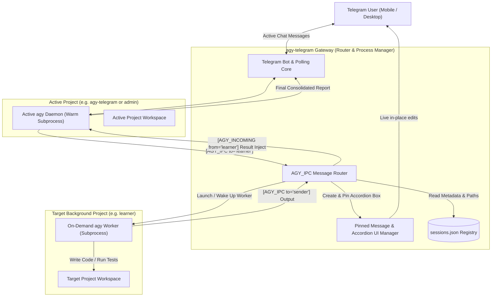
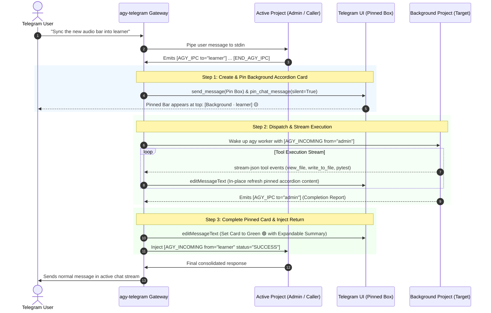

# Cross-Project Decentralized Multi-Agent Mesh & Telegram Pinned Accordion Protocol (AGY_IPC)

**Status:** Proposed & Approved for Review  
**Date:** 2026-08-20  
**Target Projects:** `agy-telegram`, `learner`, `news`, `admin`, and any future workspaces  
**Author:** Antigravity Architecture Team  

---

## 1. Executive Summary & Problem Statement

### 1.1 Context
Currently, `agy-telegram` manages multiple workspaces (`learner`, `agy-telegram`, `news`, etc.) as isolated silos with individual `conversation_id`s and separate physical working directories. Only one active project interacts with the user at any given time.

### 1.2 Motivation
In real-world development, features implemented in one project (e.g., audio scrubbing bars or refined HTML parsers in `agy-telegram`) frequently need to be synchronized to another project (e.g., `learner`). Furthermore, users may want a centralized `admin` project acting as a high-level orchestrator without constantly issuing `/open <project>` commands in Telegram.

### 1.3 Goals
1. **Decentralized P2P Agent Mesh**: Any project's Agent can trigger tasks in any other project simply by referencing the project's logical name (e.g. `learner`), without knowing UUIDs or filesystem paths.
2. **Zero-ID Coupling**: Individual Agents remain loosely coupled; `agy-telegram` serves as the centralized message bus, process dispatcher, and router.
3. **Dedicated Pinned Accordion UI**: Non-active background project logs, tool steps, test results, and replies are fully encapsulated into **a single pinned Telegram message with native expandable block (`<blockquote expandable>`)**, ensuring zero chat pollution in the active conversation stream.
4. **Resilient Feedback Loop**: Successful completions and runtime errors (e.g., failed tests) are automatically packaged and injected back into the calling project's standard input for synthesis and error recovery.

---

## 2. Architecture Overview & Component Diagram



---

## 3. Communication Protocol Specification (AGY_IPC)

### 3.1 Outbound Call Block (Sender Agent $\rightarrow$ Gateway)
When an Agent needs to delegate a task or query another project, it emits an `AGY_IPC` block:

```text
[AGY_IPC to="<target_project_name>"]
<Clear, actionable task instructions and context>
[END_AGY_IPC]
```

*Example from `agy-telegram` to `learner`:*
```markdown
I have finished implementing the new floating audio player in our gateway.

[AGY_IPC to="learner"]
We have updated our audio player specs. Please synchronize this into learner:
1. Support scrubbing and duration formatting.
2. Synchronize play/pause state between message bubbles and the bottom bar.
3. Run pytest to ensure all 36 test cases pass 100%.
[END_AGY_IPC]
```

---

### 3.2 Inbound Envelope Header (Gateway $\rightarrow$ Target Agent)
The gateway extracts the block, locates the target project's path and `conversation_id`, and injects the message into the target project's `stdin` wrapped with an envelope header:

```markdown
[AGY_INCOMING from="<source_project>" to="<target_project>" time="YYYY-MM-DD HH:MM:SS"]
<Task instructions from source project>
[END_AGY_INCOMING]

(System Directive: This is an automated cross-project collaboration request from [<source_project>]. Please execute the requested modifications and tests in your workspace, then reply with your execution summary using [AGY_IPC to="<source_project>"]...[END_AGY_IPC].)
```

---

### 3.3 Target Reply Block (Target Agent $\rightarrow$ Gateway)
Upon completing the task in its own repository, the target Agent outputs its summary:

```text
[AGY_IPC to="agy-telegram"]
Synchronization complete in learner:
1. Updated `templates/static/js/composables/useModals.js` and `store.js`.
2. Verified audio scrubbing and reactive state synchronization.
3. Ran pytest: 36 / 36 tests passed (100%).
[END_AGY_IPC]
```

---

### 3.4 Return Injection Header (Gateway $\rightarrow$ Sender Agent)
The gateway injects the result back into the calling Agent's stdin session:

```markdown
[AGY_INCOMING from="<target_project>" to="<source_project>" status="SUCCESS|ERROR"]
<Summary or error details from target project>
[END_AGY_INCOMING]
```

If the target project encountered a runtime failure (e.g. broken tests), `status="ERROR"` is passed with the failure logs so the sender Agent can diagnose or instruct a retry.

---

## 4. End-to-End Execution Sequence Diagram



---

## 5. Telegram Pinned Accordion UI Design

### 5.1 Telegram API Constraints & Capabilities
- **Multiple Pinned Messages**: Supported natively by Telegram. A pinned bar counter (`1/2`, `2/3`) appears at the top of the chat.
- **Silent Pinning**: Calls `pin_chat_message(chat_id=..., message_id=..., disable_notification=True)` to avoid audible distractions.
- **Native Expandable Block**: Uses `<blockquote expandable>...</blockquote>` HTML tags. Mobile users see a compact header with a clean `Show more` toggle.

### 5.2 Card Visual Layouts

#### A. Running State (Live in-place editing):
```html
📌 <b>[Background Task · learner]</b> 🟡 <i>In Progress (4.2s)</i>

<blockquote expandable>
<b>Task:</b> Synchronize floating audio scrubbing bar
———
• 📄 <code>view_file: store.js</code> (1.1s)
• ✏️ <code>replace_file_content: useModals.js</code> (0.8s)
• ⚙️ <code>pytest tests/ (36 items)</code> (Running...)
———
⏱ <i>Executing tools and running unit tests in workspace...</i>
</blockquote>
```

#### B. Completed State (Collapsed with Full Details Accessible):
```html
📌 <b>[Background Task · learner]</b> 🟢 <i>Completed in 6.5s</i>

<blockquote expandable>
<b>Task:</b> Synchronize floating audio scrubbing bar
———
• 📄 <code>view_file: store.js</code> (1.1s)
• ✏️ <code>replace_file_content: useModals.js</code> (0.8s)
• ✅ <code>pytest tests/: 36 / 36 passed (100%)</code> (2.4s)
———
<b>Result from learner:</b>
Code modified and validated. Scrubbing and reactive state syncing are fully operational.
</blockquote>
```

#### C. Error / Alert State:
```html
📌 <b>[Background Task · learner]</b> 🔴 <i>Task Error (5.1s)</i>

<blockquote expandable>
<b>Task:</b> Synchronize floating audio scrubbing bar
———
• ❌ <code>pytest failed: AssertionError in test_sync (L42)</code>
———
⚠️ <i>Error trace forwarded to [agy-telegram] for self-repair.</i>
</blockquote>
```

---

## 6. Implementation Plan & Module Breakdown

### 6.1 `gateway/ipc_router.py` (New Router Engine)
- **`IPCRouter` Class**:
  - `parse_ipc_calls(text: str) -> List[IPCCall]`
  - `format_incoming_envelope(source, target, body, status) -> str`
  - `execute_cross_project_call(call: IPCCall, chat_id: int, bot: Any) -> IPCResult`
  - Loop detection & TTL counter (maximum 5 hops to prevent recursive call deadlocks).

### 6.2 `gateway/agy_bridge.py` (Multi-Worker Execution Extension)
- Support spawning and streaming background `AgyBridge` workers for non-active workspaces without tearing down the active project's session.
- Automatic temporary process lifecycle: Terminate or park worker after task completion.

### 6.3 `gateway/message_formatter.py` (Accordion & Envelope Helpers)
- Support `<blockquote expandable>` rendering and clean serialization for Telegram HTML.
- Strip raw `[AGY_IPC]` tags from user-facing active chat messages.

### 6.4 `gateway/bot.py` (Pinned Message Lifecycle Hooks)
- Add helper methods `pin_collapsible_task_card(...)` and `update_pinned_task_card(...)`.
- Optional auto-unpin setting (`auto_unpin_after_seconds = 30` or keep pinned until user dismisses).

---

## 7. Security, Sandboxing & Safety Safeguards

1. **Target Project Whitelist Validation**: Requests to projects not registered in `sessions.json` are rejected immediately with descriptive errors.
2. **Infinite Loop Protection**: All `AGY_IPC` messages carry a `hop_count` header; requests exceeding `MAX_HOPS = 5` are aborted.
3. **Workspace Isolation**: Each worker process is strictly confined to its own project working directory via `--add-dir <target_path>`.
4. **Task Timeout Protection**: Background tasks enforce a strict timeout (default: 300s / 5 minutes) to prevent runaway subprocesses.

---

## 8. Verification & Test Strategy

1. **Unit Tests (`tests/test_ipc_router.py`)**:
   - Verify parsing of `[AGY_IPC to="..."]` blocks and edge cases.
   - Verify envelope injection formatting and return headers.
   - Verify loop detection and project existence checks.
2. **Integration Tests (`tests/test_mesh_collaboration.py`)**:
   - Mock cross-project invocation (`agy-telegram` $\rightarrow$ `learner`).
   - Validate pinned message creation, in-place edits, and return injection.
   - Validate error capture and propagation.
3. **End-to-End Verification**:
   - Trigger a live cross-project synchronization between `agy-telegram` and `learner` via Telegram chat.
